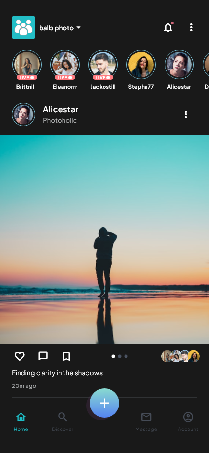
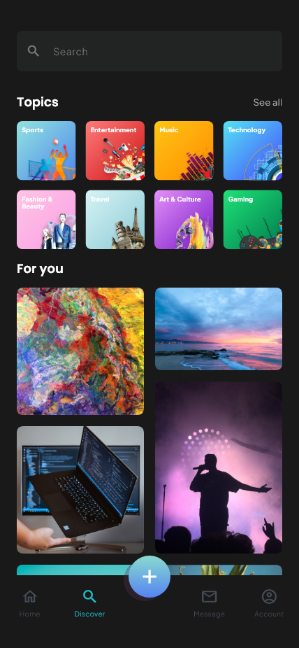
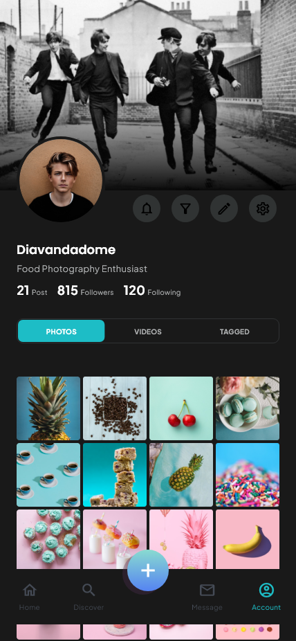
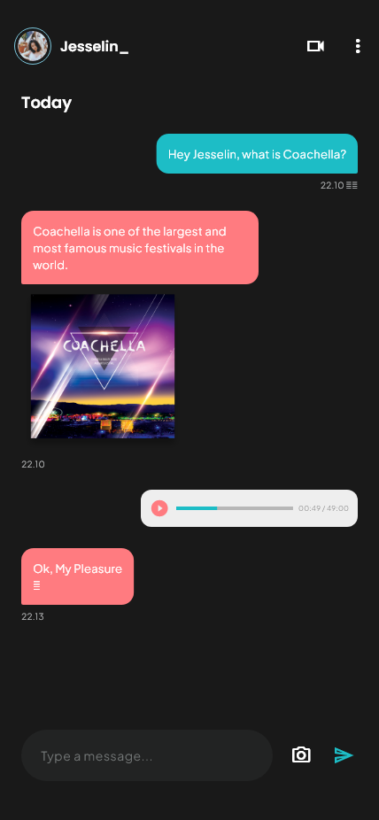
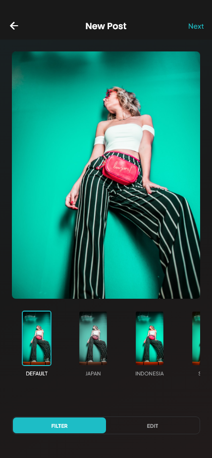
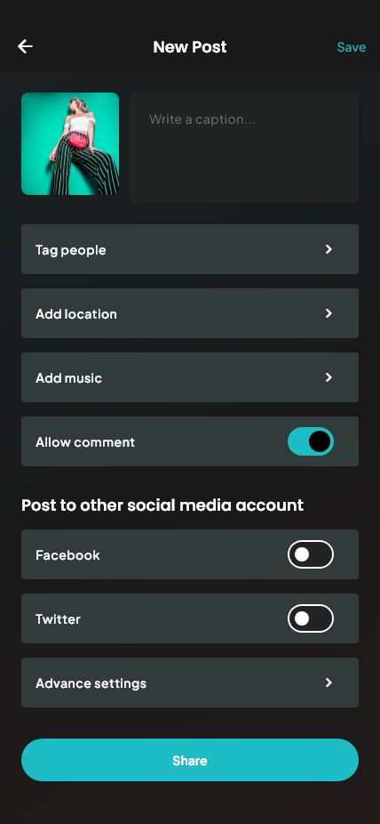

# Balb · Flutter 社交应用

依据 Pixso **Balb - Social Media App UI Kit** 开发的可交互 Flutter App。保留原稿英文界面、深色视觉、青绿色主色与图片内容，接通引导、账号、动态、发现、发布、消息和个人中心。

当前为本地数据演示版。真实认证、第三方登录、相机、音视频和在线社交服务尚未接入。

Android 安装包：[Balb 1.0.0（arm64 / x86_64）](artifacts/Balb-1.0.0-android.apk)。

## 主要界面

以下来自本项目 Flutter 控件的实际渲染，非原稿截图。完整目录见 [界面截图](docs/SCREENSHOTS.md)。

| 首页动态 | 发现与话题 | 个人中心 |
| --- | --- | --- |
|  |  |  |

| 消息会话 | 图片编辑 | 发布动态 |
| --- | --- | --- |
|  |  |  |

## 设计稿分类与页面覆盖

已读取文件中的三个页面分类：

| 分类 | 内容 | 实现处理 |
| --- | --- | --- |
| 📱 Design | 50 个 428 × 926 移动画板 | 按独立页面及表单状态实现 |
| ⚙️ Design System | 字体、颜色、图标、组件 | 统一主题与复用组件；图标使用 Flutter Material Icons 对应实现 |
| 🖼 Preview | 12 个封面、产品卡、Hero 与展示排版 | 展示分类，不额外作为 App 功能页面 |

“Typing”“Active”复用真实输入框、焦点与校验逻辑，不复制整页。三种首页样式均保留，可从首页右上角菜单切换。

- [原稿 50 画板与 Flutter 页面对应表](docs/PAGE_MAP.md)
- [64 张实现截图索引](docs/SCREENSHOTS.md)
- [验证记录](docs/VALIDATION.md)
- [原稿节点清单](docs/design/frames.json) / [独立素材节点清单](docs/design/assets.json)

## 功能与使用

| 模块 | 已实现行为 |
| --- | --- |
| 引导 | 三屏滑动、下一步、跳过、记住引导完成状态 |
| 账号 | 登录注册校验、密码显示切换、验证码输入、找回密码完整 UI 流程 |
| 初始化 | 姓名/用户名、资料编辑、生日选择、兴趣多选、推荐关注 |
| 动态 | 三种布局、Following/Trending/Suggested 切换、照片轮播、双击点赞、收藏、评论入口 |
| 发现 | 八类话题、瀑布流、话题页、账号搜索、结果类型切换与空状态 |
| 发布 | 样片/示例相册、四种滤镜、亮度/对比度/饱和度、旋转、文案、标签/地点/音乐名称、允许评论、发布后刷新动态 |
| 消息 | 联系人、会话列表、文字发送、分联系人消息记录、故事回复 |
| 个人中心 | 图片网格、视频入口、Tagged 空状态、资料/头像/封面编辑、收藏列表 |
| 设置 | 账号、隐私/通知本地开关、安全、语言、帮助、关于、退出确认 |
| 媒体预览 | 故事回复、直播评论/点赞、通话计时和镜头/麦克风开关、结束预览 |

演示登录接受格式正确的邮箱和至少 8 位密码，不创建服务器账号、不保存密码。演示验证码为 **1234**。找回密码展示交互流程，不修改远程账号。

相机、视频、直播、语音和通话使用设计稿静态素材展示对应 UI，不产生真实音视频。第三方登录、导入联系人和跨平台分享会提示需要连接服务。相册多选可预览，发布使用当前高亮的单张图片。音乐、地点和标签保存为文字；资料图片在项目提供的素材之间切换，不读取系统照片库。

## 项目结构与架构

```text
BalbSocialMedia/
├─ lib/
│  ├─ main.dart                     # 系统外观初始化、本地状态恢复
│  ├─ app.dart                      # App 入口、命名路由、页面清单
│  ├─ core/
│  │  ├─ theme.dart                 # 颜色、字体、表单、按钮主题
│  │  ├─ store.dart                 # SocialStore + StoreScope
│  │  └─ post_draft.dart            # 发布草稿、滤镜参数、序列化
│  ├─ shared/
│  │  ├─ widgets.dart               # 图片、头像、表单、页面容器等
│  │  └─ post_photo.dart            # 统一图片滤镜和旋转渲染
│  └─ features/
│     ├─ auth/auth_screens.dart
│     ├─ feed/shell.dart            # 主导航与浮动发布按钮
│     ├─ feed/feed_screen.dart      # 三种首页及复用动态卡片
│     ├─ discover/discover_screen.dart
│     ├─ post/post_screens.dart
│     ├─ messages/message_screens.dart
│     ├─ media/media_screens.dart
│     └─ account/                  # 资料、设置、初始化流程
├─ assets/images/                  # 独立照片、头像与插画
├─ assets/fonts/                   # 本地字体和 OFL 许可
├─ test/app_test.dart              # 持久化、布局和主要交互测试
├─ tool/capture_screens_test.dart   # Flutter 渲染截图生成
├─ integration_test/app_test.dart   # Android 设备截图与交互脚本
├─ test_driver/screenshots.dart    # 设备截图保存
├─ docs/design/                    # 50 张原稿图与源节点信息
├─ docs/screenshots/               # 64 张实现截图
├─ android/                        # Android 工程
├─ ios/                            # iOS 工程
└─ web/                            # Flutter Web 入口
```

### 数据与状态流

页面操作 → 更新 `SocialStore` → `notifyListeners()` → `StoreScope` 通知依赖页面重建 → 序列化写入本地存储。

- `SocialStore` 管理当前演示用户、关注、点赞、收藏、帖子、评论、分联系人消息、兴趣和设置。帖子使用稳定 ID，新增帖子不会改变收藏的指向。
- `PostDraft` 独立维护图片、文案和调色参数。发布后保留滤镜及旋转信息，动态与收藏页共用相同的图片组件。
- `SharedPreferences` 以 `balb.v1` 保存非敏感演示数据。退出保留本地活动，重新打开后恢复；没有服务器、多用户数据库和密码存储。
- `ShellScreen` 保留四个主标签的状态，中间加号进入发布流程，其余详情使用 Flutter `Navigator` 命名路由。
- 按业务划分特性目录，表单状态、首页样式、资料页和媒体页通过参数复用。运行时仅依赖 Flutter SDK 与 `shared_preferences`。

后续接入后端时，可为认证、动态、会话、媒体增加仓库接口，将本地更新替换为服务调用，继续复用现有界面组件。

## 运行与验证

本次环境：Flutter **3.47.7**、Dart **3.13.5**。图片与字体均随项目提供，安装依赖后 UI 演示无需联网。

```powershell
flutter pub get
flutter devices
flutter run -d emulator-5554
# 或运行 Web
flutter run -d chrome
```

iOS 需在 macOS 安装 Xcode 后构建，本次 Windows 环境未验证。正式发布前需要配置生产签名；当前 Android 使用演示签名。

```powershell
flutter analyze
flutter test test/app_test.dart

# 更新实际界面截图
flutter test tool/capture_screens_test.dart --update-goldens

# 有可用 Android 设备时运行
flutter drive --driver=test_driver/screenshots.dart --target=integration_test/app_test.dart -d emulator-5554

# Android 安装包
flutter build apk --release --target-platform android-arm64,android-x64
```

截图脚本先加载字体、图标和图片，再以 428 × 926 尺寸渲染。系统状态栏和系统键盘不属于这批 Flutter 渲染截图；输入时由设备输入法承担。模拟器中断情况与各项验证结果见 [验证记录](docs/VALIDATION.md)。

## 代码精简与素材

移除了默认计数器、未使用的 Cupertino 图标依赖和重复表单页面。主题、头像、表单、页面容器、关注按钮、动态卡片与图片处理控件集中复用。参考整页图仅存放在 `docs/`，未当作 App 页面背景。字体许可位于 `assets/fonts/`。图片来自用户提供的 Pixso 设计稿，权利归原素材权利人所有。
