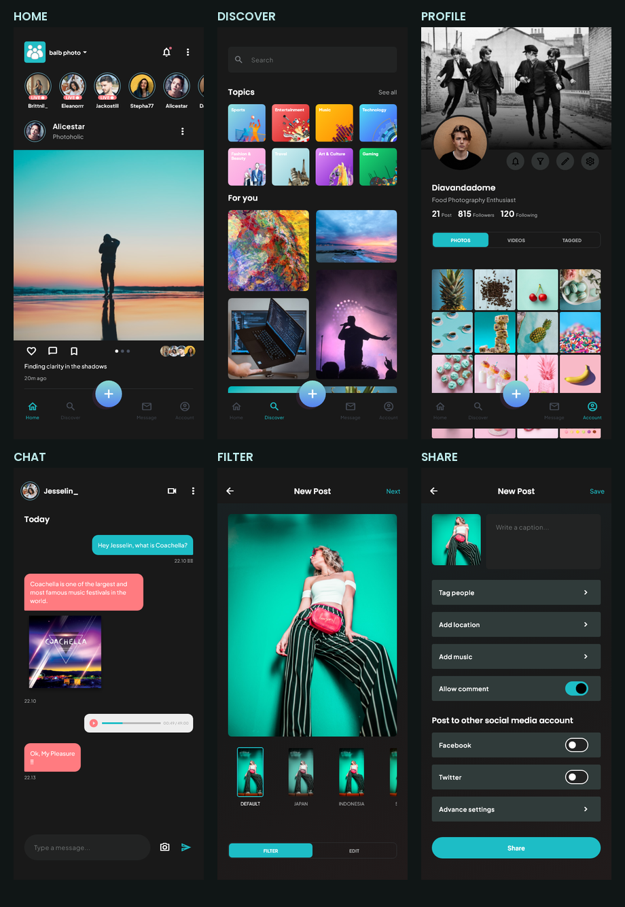

# 界面截图目录

共 **64 张单独界面截图**，由 `tool/capture_screens_test.dart` 使用 Flutter 测试渲染器生成，尺寸均为 **428 × 926**。预加载原项目字体、Material 图标与全部图片后再截图；不是把 Pixso 页面当作实现截图。另提供一张主要页面概览。

原稿 50 张参考图位于 `design/`，逐页对应关系见 [PAGE_MAP.md](PAGE_MAP.md)。本批截图不含设备系统状态栏与系统键盘；Typing 展示真实焦点与内容，Active 展示填写完成后的状态。Android 模拟器因磁盘空间耗尽掉线，当前未将本批截图标为模拟器截图。

另附 [最终 Release 安装包在 Android 模拟器中的启动截图](device-screenshots/onboarding.png)。设备自动化未完整完成，详情见 [验证记录](VALIDATION.md)。



## 引导与账号

| 页面 / 状态 | 图片 |
| --- | --- |
| splash | [打开截图](screenshots/splash.png) |
| onboarding | [打开截图](screenshots/onboarding.png) |
| onboarding-2 | [打开截图](screenshots/onboarding-2.png) |
| onboarding-3 | [打开截图](screenshots/onboarding-3.png) |
| sign-up | [打开截图](screenshots/sign-up.png) |
| sign-in | [打开截图](screenshots/sign-in.png) |
| recovery | [打开截图](screenshots/recovery.png) |
| reset-code | [打开截图](screenshots/reset-code.png) |
| new-password | [打开截图](screenshots/new-password.png) |
| password-success | [打开截图](screenshots/password-success.png) |
| confirmation | [打开截图](screenshots/confirmation.png) |
| setup-name | [打开截图](screenshots/setup-name.png) |
| complete-profile | [打开截图](screenshots/complete-profile.png) |
| interests | [打开截图](screenshots/interests.png) |
| find-friends | [打开截图](screenshots/find-friends.png) |

## 动态与发现

| 页面 / 状态 | 图片 |
| --- | --- |
| home | [打开截图](screenshots/home.png) |
| home-v2 | [打开截图](screenshots/home-v2.png) |
| home-v3 | [打开截图](screenshots/home-v3.png) |
| video | [打开截图](screenshots/video.png) |
| live | [打开截图](screenshots/live.png) |
| story | [打开截图](screenshots/story.png) |
| comments | [打开截图](screenshots/comments.png) |
| notifications | [打开截图](screenshots/notifications.png) |
| discover | [打开截图](screenshots/discover.png) |
| search | [打开截图](screenshots/search.png) |
| topics | [打开截图](screenshots/topics.png) |
| topic-travel | [打开截图](screenshots/topic-travel.png) |
| post-detail | [打开截图](screenshots/post-detail.png) |

## 发布流程

| 页面 / 状态 | 图片 |
| --- | --- |
| camera | [打开截图](screenshots/camera.png) |
| gallery | [打开截图](screenshots/gallery.png) |
| filter | [打开截图](screenshots/filter.png) |
| edit | [打开截图](screenshots/edit.png) |
| share | [打开截图](screenshots/share.png) |
| published-post | [打开截图](screenshots/published-post.png) |

## 消息与个人中心

| 页面 / 状态 | 图片 |
| --- | --- |
| messages | [打开截图](screenshots/messages.png) |
| chat | [打开截图](screenshots/chat.png) |
| chat-sent | [打开截图](screenshots/chat-sent.png) |
| call | [打开截图](screenshots/call.png) |
| profile | [打开截图](screenshots/profile.png) |
| user | [打开截图](screenshots/user.png) |
| edit-profile | [打开截图](screenshots/edit-profile.png) |
| saved | [打开截图](screenshots/saved.png) |
| saved-populated | [打开截图](screenshots/saved-populated.png) |

## 设置

| 页面 / 状态 | 图片 |
| --- | --- |
| settings | [打开截图](screenshots/settings.png) |
| settings-privacy | [打开截图](screenshots/settings-privacy.png) |
| settings-notification | [打开截图](screenshots/settings-notification.png) |
| settings-security | [打开截图](screenshots/settings-security.png) |
| settings-language | [打开截图](screenshots/settings-language.png) |
| settings-help | [打开截图](screenshots/settings-help.png) |
| settings-about-us | [打开截图](screenshots/settings-about-us.png) |

## 真实表单状态

| 页面 / 状态 | 图片 |
| --- | --- |
| sign-up-typing | [打开截图](screenshots/sign-up-typing.png) |
| sign-up-active | [打开截图](screenshots/sign-up-active.png) |
| sign-in-typing | [打开截图](screenshots/sign-in-typing.png) |
| sign-in-active | [打开截图](screenshots/sign-in-active.png) |
| recovery-typing | [打开截图](screenshots/recovery-typing.png) |
| recovery-active | [打开截图](screenshots/recovery-active.png) |
| reset-code-typing | [打开截图](screenshots/reset-code-typing.png) |
| reset-code-active | [打开截图](screenshots/reset-code-active.png) |
| new-password-typing | [打开截图](screenshots/new-password-typing.png) |
| new-password-active | [打开截图](screenshots/new-password-active.png) |
| confirmation-typing | [打开截图](screenshots/confirmation-typing.png) |
| confirmation-active | [打开截图](screenshots/confirmation-active.png) |
| setup-name-typing | [打开截图](screenshots/setup-name-typing.png) |
| setup-name-active | [打开截图](screenshots/setup-name-active.png) |

## 重新生成

```powershell
flutter test tool/capture_screens_test.dart --update-goldens
```

具有可用 Android 设备时，也可使用设备脚本：

```powershell
flutter drive --driver=test_driver/screenshots.dart --target=integration_test/app_test.dart -d emulator-5554
```
