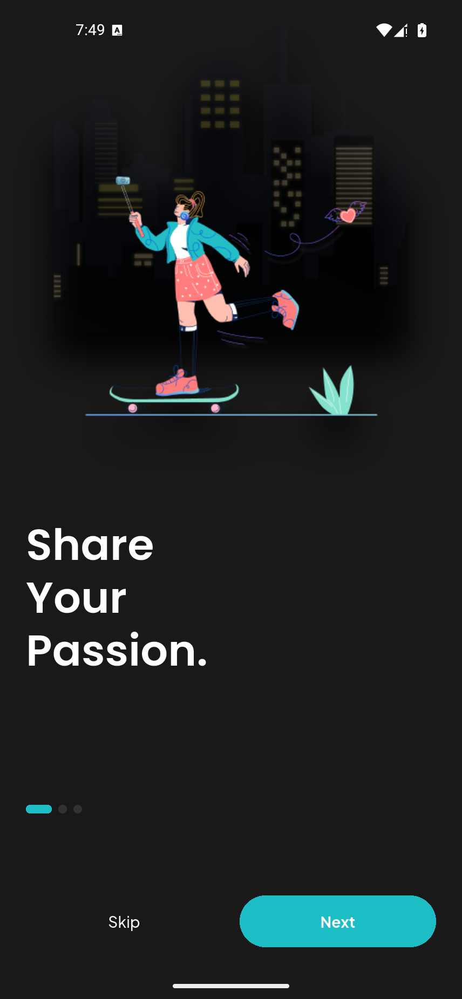

# 验证记录

验证日期：2026-11-02（Asia/Tokyo）。

## 环境与构建

- Flutter 3.47.7 / Dart 3.13.5，Windows。
- Android 15 / API 35 模拟器，另有 360 × 780、428 × 926 的 Flutter 布局检查。
- `flutter analyze`：无问题。
- `flutter test test/app_test.dart`：**5 项测试通过**。覆盖本地数据恢复、两种尺寸下全部 39 个命名入口、登录校验和发布更新。
- `flutter test tool/capture_screens_test.dart --update-goldens`：**64 项截图生成通过**。包含主页面、14 个输入状态、设置详情、话题/帖子详情和交互后的状态。
- Android Release 包已构建并检查，约 **47.4 MiB**；包含 arm64 与 x86_64 的 `libapp.so`、字体和图片。

## 安装包

[Balb-1.0.0-android.apk](../artifacts/Balb-1.0.0-android.apk)

SHA-256：

```text
C4CD667309151DF7ABBF1E2313A08F7F02AC06AF329AB664E56EC613C0207738
```

支持 arm64 真机与 x86_64 模拟器。当前使用演示签名；正式发布需配置生产签名。

## 视觉核对

- 已导出并保留 50 个 Pixso 原稿画板；逐页映射见 [PAGE_MAP.md](PAGE_MAP.md)。
- 实现图片与原稿图片区分存放；没有用整页原稿充当 Flutter 页面。
- 主界面截图人工核对了图片、图标、字体、主导航、动态内容、话题网格、个人资料、编辑和发布流程。
- 截图显式预加载字体与照片，避免异步解码导致空白。
- `docs/screenshots/` 含 64 张独立图和 1 张概览。截图为 428 × 926 的 Flutter 渲染结果，不含设备系统状态栏、系统键盘。

## Android 设备验证

最终 Release 安装包在 Android 15 / API 35 模拟器中安装成功，并实际显示了引导页面。



设备配置为 856 × 1852 像素、320 dpi。模拟器运行期间出现掉线，完整设备自动化没有完成，因此不将其记为通过。登录校验、发布更新、数据恢复和全部入口布局以 Flutter 测试结果为准。设备截图与 64 张渲染截图分开存放。

初次迁移构建缓存时发现路径别名导致 APK 缺少应用代码，已改为单一真实构建路径重新打包。交付包通过 `python tool/verify_apk.py` 的两种 ABI 运行代码、资源和 ZIP 完整性检查，并以上述最终安装启动截图为验收证据。

## 范围与限制

- 未连接服务器，登录与验证码是显式演示流程，不创建真实账号、不存储密码。
- 相机、视频、直播、语音和通话是静态设计素材的交互预览。
- 仅保存本机演示数据；跨平台分享、真实媒体上传、推送、OAuth、联系人导入尚未接入。
- iOS 工程已生成，但 Windows 无法执行 Xcode 编译与 iOS 模拟器测试。
- Web 入口已提供，本次未进行浏览器端自动化验证。
- 原稿图标采用 Material Icons 对应实现，系统输入法遵循运行设备平台，因此不宣称逐像素一致。

## 本机存储调整

本次构建期间 C 盘空间耗尽。最终 Android 构建使用 `BALB_BUILD_DIR=E:\CodexBuilds\BalbSocialMedia\build-final` 的真实目录，临时文件与新模拟器也位于本项目对应的 E 盘目录。源码和交付包仍在项目内。当前 `build/` 为普通目录，旧缓存链接保留为被 Git 忽略的 `build-previous-cache/`；没有修改其他项目或清理用户文件。未设置 `BALB_BUILD_DIR` 时项目使用标准的 `build/` 目录。
